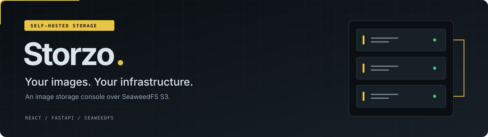
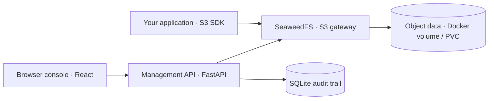

<p align="center">
  
</p>

<p align="center">
  <a href="https://github.com/imthi16/storzo/actions/workflows/ci.yml"></a>
  <a href="LICENSE"></a>
  <a href="#project-status"></a>
</p>

<p align="center">
  <strong>Browse, upload and manage images on infrastructure you run.</strong><br />
  A React console and FastAPI management API, powered by SeaweedFS S3 storage.
</p>

<p align="center">
  <a href="#quick-start">Quick start</a> ·
  <a href="#features">Features</a> ·
  <a href="#architecture">Architecture</a> ·
  <a href="#use-your-s3-sdk">S3 SDK</a> ·
  <a href="#documentation">Documentation</a>
</p>

---

Storzo brings bucket browsing, image previews, uploads and an audit trail into one self-hosted console. Objects live in your Docker volumes or Kubernetes PersistentVolumes, and applications connect directly to SeaweedFS using S3 SDKs. No AWS or GCS account is required.

> **Prototype / evaluation release.** Storzo is a management console over SeaweedFS, not an independent storage engine or a production-verified MinIO replacement. Validate compatibility, security and recovery before using company data. See [project status](#project-status).

## Features

| | What you can do |
| --- | --- |
| **Bucket & object browser** | Create buckets, navigate nested prefixes, download objects and delete files. |
| **Image workflow** | Drag and drop uploads, view thumbnails and preview images. On-demand WebP thumbnails leave originals unchanged. |
| **Shareable downloads** | Generate short-lived presigned links for objects. |
| **Storage overview** | Inspect bucket usage, file-type mix and recent objects through the console. |
| **Admin sessions & audit** | Sign in with an HttpOnly signed cookie; management writes use CSRF protection and activity is recorded in SQLite. |
| **S3 SDK access** | Connect applications directly to the upstream SeaweedFS S3 endpoint. |
| **Self-hosted deployment** | Start with Docker Compose; explore Kubernetes using the starter Helm chart. |

SHA-256 metadata is recorded for console uploads. Overview scans are capped at 3,000 objects and marked partial when capped; they are not an authoritative disk or billing meter.

## Quick start

**Requirements:** Docker Engine with Docker Compose v2, Python 3.10+, available disk space and internet access to pull images and build dependencies.

```bash
git clone https://github.com/imthi16/storzo.git
cd storzo

# Generate local admin and S3 credentials; preserves an existing .env.
python3 scripts/setup_env.py

docker compose up -d --build
docker compose ps
```

Open **[localhost:8088](http://localhost:8088)** and sign in as `admin`. Retrieve the generated password locally:

```bash
grep '^ADMIN_PASSWORD=' .env
```

The `demo-images` bucket is initialized by SeaweedFS. Create additional buckets in the console. Keep `.env` private.

| Service | Local address |
| --- | --- |
| Web console & management API | `http://localhost:8088` |
| S3 endpoint for application SDKs | `http://localhost:8333` |
| Liveness / readiness | `/api/health/live` / `/api/health/ready` on the console address |

Both published ports bind to loopback by default. Image selection follows `SEAWEEDFS_TAG` in `.env`; review it and pin an immutable image digest for production deployments.

<details>
<summary><strong>Check health or troubleshoot startup</strong></summary>

```bash
curl -f http://localhost:8088/api/health/live
curl -f http://localhost:8088/api/health/ready
docker compose logs --tail=100 storage backend frontend
```

The backend waits for storage connectivity; initial image builds and startup may take time.

</details>

> **Keep your data:** `docker compose down -v` deletes named persistent volumes. Use `docker compose stop` or `docker compose down` without `-v` to retain them. Persistent volumes are not a backup.

## Architecture



**Storzo manages the console experience. SeaweedFS stores the objects.** The FastAPI API handles console sessions, management operations, thumbnails and audit records. Application SDK traffic goes directly to SeaweedFS.

| Layer | Technology |
| --- | --- |
| Console | React 19, TypeScript, Vite |
| Management API | FastAPI, Python, SQLite |
| Object storage | SeaweedFS S3 gateway |
| Deployment | Docker Compose, starter Helm chart |

Read the [architecture guide](docs/ARCHITECTURE.md) for data flow and trust boundaries.

## Use your S3 SDK

Install `boto3` in your Python environment:

```bash
python3 -m pip install boto3
```

Use your generated `S3_ACCESS_KEY` and `S3_SECRET_KEY` from `.env` in place of the placeholders:

```python
import boto3
from botocore.config import Config

s3 = boto3.client(
    "s3",
    endpoint_url="http://localhost:8333",
    aws_access_key_id="YOUR_S3_ACCESS_KEY",
    aws_secret_access_key="YOUR_S3_SECRET_KEY",
    region_name="us-east-1",
    config=Config(
        signature_version="s3v4",
        s3={"addressing_style": "path"},
    ),
)

s3.upload_file("example.png", "demo-images", "photos/example.png")
print(s3.list_objects_v2(Bucket="demo-images"))
```

Within the Compose network, use `http://storage:8333`. Presigned browser links must use an endpoint reachable by the browser, configured through `S3_PUBLIC_ENDPOINT`. Validate the S3 operations your application needs against SeaweedFS before migrating.

## Development & verification

Run backend tests with a fake S3 adapter; no Docker is needed:

```bash
cd backend
python3 -m pip install -r requirements-dev.txt
python3 -m pytest -q
```

Build the console from the repository root:

```bash
cd frontend
npm install
npm run build
```

Against a running local Docker stack, install `boto3` on the host and run from the repository root:

```bash
python3 -m pip install boto3
python3 scripts/smoke_test.py
bash scripts/verify_restart.sh
```

For the combined Docker build, S3 smoke and restart/checksum workflow, use `bash scripts/demo_verify.sh`. These integration checks create test data and restart services; use a demo environment.

CI defines backend tests, a frontend build and Compose configuration validation. Historical results and remaining acceptance gates are recorded in [build verification](docs/BUILD_VERIFICATION.md); they are not evidence of production readiness.

## Project status

Storzo is an **MVP for isolated evaluation**, including a possible MinIO migration assessment. Implemented source and deployment configuration still require validation in your environment.

| Area | Current boundary |
| --- | --- |
| Identity | Single admin; enterprise auth, MFA and multi-user IAM are not included. |
| Deployment | Single-node demo; multi-node HA and disaster recovery are not proven. |
| Compatibility | S3 behavior is supplied by SeaweedFS; MinIO feature parity is not established. |
| Security | TLS ingress, rate limiting, external secret management and security review remain production requirements. |
| Recovery | A same-host cold backup/restore drill script exists; off-host recovery and RPO/RTO targets remain unproven. |

Versioned-bucket deletes can create delete markers instead of reclaiming storage immediately. Self-hosting also carries server, disk, backup, network and maintenance costs.

Keep existing production storage untouched during evaluation. Before cutover, verify SDK compatibility, backups and restore, bucket policies, TLS and a rollback plan. See the [feature matrix](docs/FEATURE_MATRIX.md), [migration guide](docs/MIGRATION.md) and [security checklist](docs/SECURITY_CHECKLIST.md).

## Documentation

<details>
<summary><strong>Kubernetes demo setup</strong></summary>

Requires `kubectl`, `helm`, a working cluster with a default StorageClass, and permission to install resources. Build and push the images to a registry your cluster can access:

```bash
docker build -t registry.example.com/team/storzo-backend:0.1.0 ./backend
docker build -t registry.example.com/team/storzo-frontend:0.1.0 ./frontend
docker push registry.example.com/team/storzo-backend:0.1.0
docker push registry.example.com/team/storzo-frontend:0.1.0

export BACKEND_IMAGE=registry.example.com/team/storzo-backend:0.1.0
export FRONTEND_IMAGE=registry.example.com/team/storzo-frontend:0.1.0
bash scripts/k8s_demo_install.sh
```

Replace the example registry paths with your own. The bootstrap creates the `storzo-demo` namespace, installs the upstream SeaweedFS chart, creates a credentials Secret and deploys the Storzo chart. Use a nonproduction environment and review demo values before installation.

```bash
kubectl -n storzo-demo port-forward svc/storzo-storzo-frontend 8088:80
# In a second terminal, for browser-accessible presigned links:
kubectl -n storzo-demo port-forward svc/seaweedfs-s3 8333:8333
```

Open `http://localhost:8088`. Production deployment needs TLS ingress, external secret management and a properly sized, redundant storage deployment. The SQLite audit backend uses one replica.

</details>

| Guide | Start here for |
| --- | --- |
| [Demo walkthrough](docs/TL_DEMO.md) | A five-minute demonstration and acceptance script |
| [Architecture](docs/ARCHITECTURE.md) | Storage, management plane and trust boundaries |
| [Feature matrix](docs/FEATURE_MATRIX.md) | Implemented, upstream-provided and planned capabilities |
| [Deployment configuration](deploy/) | Starter Helm chart and SeaweedFS demo values |
| [Migration](docs/MIGRATION.md) | Staged MinIO evaluation and cutover requirements |
| [Security checklist](docs/SECURITY_CHECKLIST.md) | Requirements before production exposure |
| [Build verification](docs/BUILD_VERIFICATION.md) | Recorded checks and outstanding validation |
| [Release status](docs/RELEASE_STATUS.md) | Dated MVP release notes and demo checklist |

## Contributing

Use a focused feature branch and include relevant validation with your pull request. Run backend tests or the frontend build for changes to those components. Never commit `.env`, credentials, company data or customer files.

[Report an issue](https://github.com/imthi16/storzo/issues) · [Open a pull request](https://github.com/imthi16/storzo/pulls)

## License & attribution

Storzo is licensed under the **[MIT License](LICENSE)**.

[SeaweedFS](https://github.com/seaweedfs/seaweedfs) is an independent upstream project with its own license and notices. Storzo is not affiliated with SeaweedFS, MinIO or RustFS; Storzo's license does not relicense third-party software.
